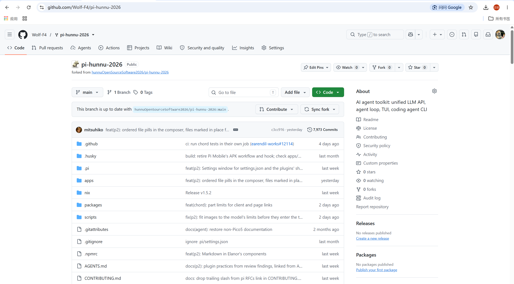
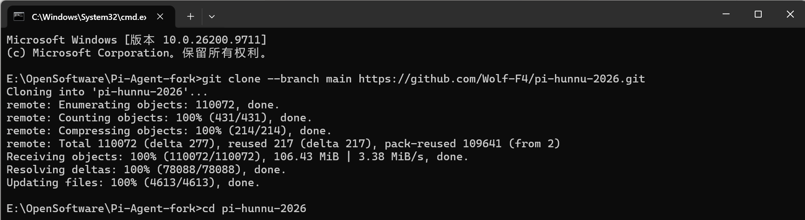
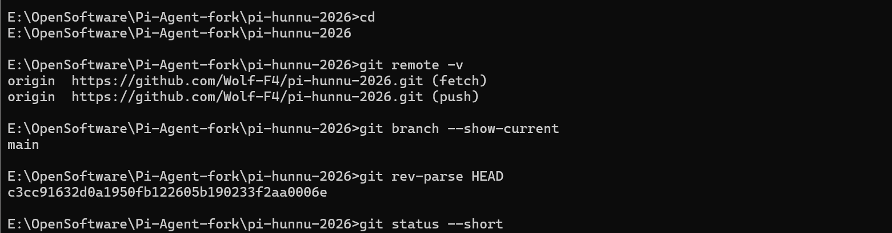
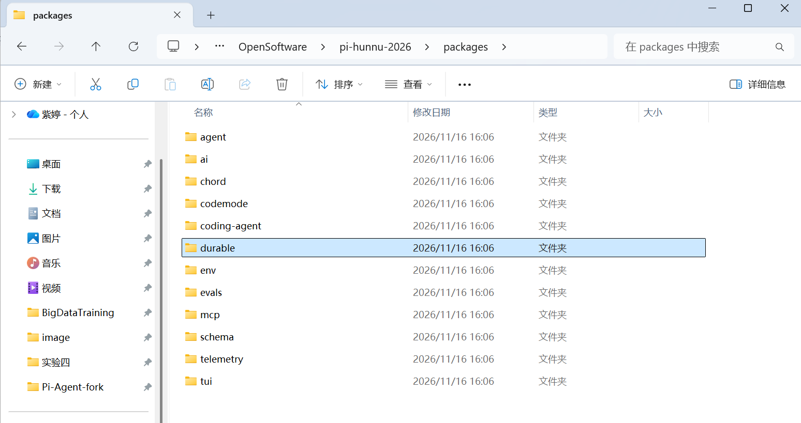
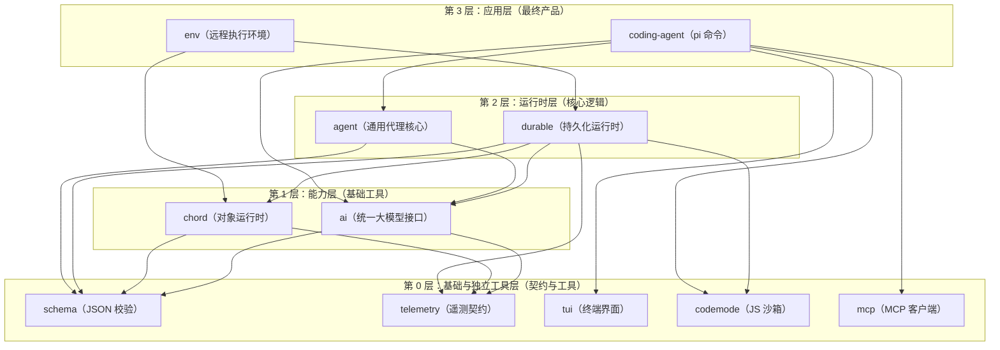

# 实践课2：组织建仓与源码分析实践报告

## 基本信息

| 项目 | 内容 |
|---|---|
| 姓名 | 曾紫婷 |
| 学号 | 202430224004 |
| GitHub 登录名 | zinnia1214 |
| 所在小组 | 第 13 组（组织：Wolf-F4） |
| 分析所用提交 | `c3cc91632d0a1950fb122605b190233f2aa0006e` |

---

## 一、小组组织仓库

本组的小组代码仓库由组长从课程仓库 fork 建立：

- **小组组织**：`Wolf-F4`
- **小组仓库**：https://github.com/Wolf-F4/pi-hunnu-2026
- **fork 来源**：`hunnuOpenSourceSoftware2026/pi-hunnu-2026`（课程仓库）
- **全体组员**：均已加入 Wolf-F4 组织，具有仓库访问权限

**组织仓库页面截图**：


---

## 二、源码获取

### 2.1 下载源码

在全英文路径下执行（CMD）：

```bash
git clone --branch main https://github.com/Wolf-F4/pi-hunnu-2026.git
cd pi-hunnu-2026
```

**实际 clone 地址（文本）**：`https://github.com/Wolf-F4/pi-hunnu-2026.git`

### 2.2 确认源码来源和版本

依次执行确认命令，结果如下：

| 命令 | 实际输出 | 结论 |
|---|---|---|
| `cd` (或 `Get-Location` / `pwd`) | `E:\OpenSoftware\Pi-Agent-fork\pi-hunnu-2026` | 源码已在本地 |
| `git remote -v` | `origin https://github.com/Wolf-F4/pi-hunnu-2026.git`（fetch/push 两行） | origin 指向小组组织仓库 |
| `git branch --show-current` | `main` | 当前分支为 main |
| `git rev-parse HEAD` | `c3cc91632d0a1950fb122605b190233f2aa0006e` | 与课程仓库 main 一致 |
| `git status --short` | （无输出） | 工作区干净 |

**截图（当前目录、远端地址、分支与提交编号）**：

  


**源码目录结构截图**：
 

---

## 三、构建体系总览

仓库根目录的 `package.json` 表明这是一个 npm monorepo，通过 `workspaces` 把 `packages/*` 等目录统一管理。

**根目录 `npm run build` 的工作**：
- 读取根目录的 `package.json` 脚本，通常通过 `scripts/package-files.mjs` 或直接调用 `tsc` 遍历子模块。
- **执行顺序**（基于依赖拓扑排序）：
  1. **基础层**：`telemetry`、`schema`（读取 `tsconfig.build.json`，执行 `tsc`，生成 `dist/`）
  2. **运行时层**：`chord`、`tui`、`codemode`、`mcp`（读取 `tsconfig.build.json`，`tui` 额外执行原生构建，生成 `dist/` 或二进制）
  3. **核心逻辑层**：`ai`、`agent`（`ai` 额外执行 `generate-models` 生成模型数据，`agent` 仅 `tsc`，生成 `dist/`）
  4. **持久化与环境层**：`durable`、`env`（`durable` 仅 `tsc`，`env` 额外执行 Rust 守护进程构建 `cargo build`，生成 `dist/` 和二进制）
  5. **应用层**：`coding-agent`（`tsc` + 资产拷贝 + Bun 构建，生成 `dist/bundle/cli.js` 和二进制）

**子模块 `npm run build` 的工作**：
- **基础模块**（`telemetry`, `schema`）：读取 `tsconfig.build.json`，执行 `tsc -p tsconfig.build.json`，生成 `dist/`。
- **运行时模块**（`chord`, `tui`, `codemode`, `mcp`）：读取 `tsconfig.build.json`，`tui` 额外执行原生构建脚本（Darwin/Linux/Win32），生成 `dist/` 和二进制。
- **核心逻辑模块**（`ai`, `agent`）：读取 `tsconfig.build.json`，`ai` 额外执行 `generate-models` 生成模型数据，生成 `dist/` 和模型目录。
- **持久化与环境模块**（`durable`, `env`）：读取 `tsconfig.build.json`，`env` 额外执行 Rust 守护进程构建（`cargo build`），生成 `dist/` 和二进制。
- **应用模块**（`coding-agent`）：读取 `tsconfig.build.json` + 资产拷贝 + Bun 构建，生成 `dist/bundle/cli.js` 和二进制。

---

## 四、模块分析表

| 子文件夹 | 代码主要实现什么功能 | 本模块 build 执行什么、生成什么 | 直接依赖哪些内部模块 | 依据文件或代码位置 |
|---|---|---|---|---|
| **`telemetry`** | 供应商中立的遥测合约和类型化架构工具（追踪、可观测性） | `tsc -p tsconfig.build.json` → 生成 `dist/` | **无**（基础模块） | `packages/telemetry/package.json` |
| **`schema`** | 无 eval 的 JSON Schema 验证（2020-12 和 7 草案，编译为纯闭包） | `tsc -p tsconfig.build.json` → 生成 `dist/` | **无**（基础模块） | `packages/schema/package.json` |
| **`chord`** | 对象运行时：合约、文档、存储、链接、插件（热重载）、HTTP、工作流、Web/终端客户端 | `tsc -p tsconfig.build.json` → 生成 `dist/` | `schema`, `telemetry` | `packages/chord/package.json` |
| **`tui`** | 终端用户界面库，带差分渲染的高效文本应用 | `tsc -p tsconfig.build.json` + 原生构建脚本（Darwin/Linux/Win32） → 生成 `dist/` 和原生二进制 | **无**（依赖外部库如 `marked`） | `packages/tui/package.json` |
| **`codemode`** | 沙盒 JavaScript 执行，唯一能力是调用注入工具（QuickJS/WASM/Cloudflare） | `tsc -p tsconfig.build.json` → 生成 `dist/` | **无**（依赖 `quickjs-wasi`） | `packages/codemode/package.json` |
| **`mcp`** | 独立的模型上下文协议（MCP）客户端 | `tsc -p tsconfig.build.json` → 生成 `dist/` | **无**（依赖 `cross-spawn`） | `packages/mcp/package.json` |
| **`ai`** | 统一 LLM API，自动模型发现和提供商配置 | `generate-models` + `tsc -p tsconfig.build.json` + 资源拷贝 → 生成 `dist/` 和模型目录 | `schema`, `telemetry` | `packages/ai/package.json` |
| **`durable`** | **持久化对话、任务和文档运行时** | `tsc -p tsconfig.build.json` → 生成 `dist/` | `chord`, `ai`, `codemode`, `schema`, `telemetry` | `packages/durable/package.json` |
| **`env`** | 远程执行环境：通过 SSH 部署的小型守护进程及其客户端 | `tsc -p tsconfig.build.json` + Rust 守护进程构建（`cargo build`） → 生成 `dist/` 和二进制 | `chord`, `durable` | `packages/env/package.json` |
| **`agent`** | 通用代理，带传输抽象、状态管理和附件支持 | `tsc -p tsconfig.build.json` → 生成 `dist/` | `ai`, `schema` | `packages/agent/package.json` |
| **`coding-agent`** | 编码代理 CLI，带读取、Bash、编辑、写入工具和会话管理 | `tsc -p tsconfig.build.json` + 资产拷贝 + Bun 构建 → 生成 `dist/bundle/cli.js` 和二进制 | `agent`, `ai`, `codemode`, `mcp`, `tui`, `telemetry`, `schema` | `packages/coding-agent/package.json` |

---

## 五、模块层级与依赖关系图

下图使用 Mermaid 绘制（箭头方向统一为 **使用方 → 被依赖方**）。



**层级划分依据**：按“只被别人依赖还是也依赖别人”分层。第 0 层五个模块的 `dependencies` 中都没有任何内部包（schema/telemetry 是被大量复用的基础契约，tui/codemode/mcp 是自成一体的独立工具）；第 1 层只依赖第 0 层；第 2 层开始组合第 0、1 层能力；第 3 层是面向用户/部署场景的最终产品。

**依赖口径说明**：图中所有箭头均来自各模块 `package.json` 的 `dependencies` 字段（运行时的直接依赖）；`devDependencies` 属于开发期依赖，未画入图中。

---

## 六、三个核心问题的回答

**1. 根目录与子模块中的 `npm run build` 分别读取什么配置、执行什么工作？**
- **根目录**：读取根 `package.json` 的 `build` 脚本。它不做编译本身，而是按固定顺序 `cd` 进 11 个模块目录，依次触发各模块自己的 `npm run build`。
- **子模块**：
  - **基础模块**（`telemetry`, `schema`）：读取 `tsconfig.build.json`，执行 `tsc -p tsconfig.build.json`，生成 `dist/`。
  - **运行时模块**（`chord`, `tui`, `codemode`, `mcp`）：读取 `tsconfig.build.json`，`tui` 额外执行原生构建脚本（Darwin/Linux/Win32），生成 `dist/` 和二进制。
  - **核心逻辑模块**（`ai`, `agent`）：读取 `tsconfig.build.json`，`ai` 额外执行 `generate-models` 生成模型数据，生成 `dist/` 和模型目录。
  - **持久化与环境模块**（`durable`, `env`）：读取 `tsconfig.build.json`，`env` 额外执行 Rust 守护进程构建（`cargo build`），生成 `dist/` 和二进制。
  - **应用模块**（`coding-agent`）：读取 `tsconfig.build.json` + 资产拷贝 + Bun 构建，生成 `dist/bundle/cli.js` 和二进制。

**2. 构建顺序和模块依赖有什么关系？相邻构建的模块是否一定互相依赖？**
- **关系**：构建顺序遵循依赖关系（拓扑排序）。被依赖者（如 `schema`）必须先于依赖者（如 `chord`）构建。
- **相邻是否一定依赖**：**不一定**。例如，`tui` 和 `codemode` 在构建顺序中相邻，但它们之间没有直接依赖（`tui` 依赖外部库，`codemode` 依赖 `quickjs-wasi`）。相邻仅表示在拓扑排序中位置接近，不代表必须依赖。

**3. 选择一条涉及至少三个模块的依赖路径，说明这些模块如何分工。**
- **路径**：`env` → `durable` → `chord` → `schema`
- **分工说明**：
  - **`env`（应用层）**：提供远程执行环境，通过 SSH 部署守护进程，调用 `durable` 和 `chord`。
  - **`durable`（运行时层）**：提供持久化对话、任务和文档运行时，调用 `chord`、`ai`、`codemode`、`schema`、`telemetry`。
  - **`chord`（能力层）**：提供对象运行时（合约、文档、存储、链接），调用 `schema` 和 `telemetry`。
  - **`schema` / `telemetry`（基础层）**：提供 JSON Schema 验证和遥测契约，不依赖其他内部模块。
- **分工逻辑**：`env` 负责远程执行，`durable` 负责状态持久化，`chord` 负责对象共享，`schema`/`telemetry` 负责数据合法性与观测。

---

## 七、本人重点分析的模块：`durable`

我选择 **`durable`（持久化运行时）** 作为重点分析模块，因为它在整个架构中扮演“粘合剂”的角色：
- **功能描述**（依据 `package.json`）：`Durable conversation, task, and document runtime for Pi`（Pi 的持久化对话、任务和文档运行时）。
- **构建工作**：执行 `tsc -p tsconfig.build.json`，生成 `dist/` 目录下的运行时代码（包括存储、工具搜索、图像处理等子模块）。
  - **特殊之处**：它包含大量的测试脚本（`test:store`, `test:workers`, `bench:*`），说明其持久化逻辑非常复杂，需要严格的性能和正确性测试。
- **直接依赖（5 个）**：
  1. `chord`（对象运行时，用于存储和链接）
  2. `ai`（统一 LLM API，用于模型调用）
  3. `codemode`（沙盒执行，用于工具运行）
  4. `schema`（JSON 校验，用于数据合法性）
  5. `telemetry`（遥测契约，用于追踪）
- **详细解说（分工与逻辑）**：
  - **核心逻辑**：`durable` 负责将对话、任务和文档的状态持久化，确保即使代理中断也能恢复。它通过 `chord` 管理对象状态（存储、链接），通过 `ai` 调用模型（生成响应），通过 `codemode` 执行工具（沙盒运行），通过 `schema` 验证数据（确保格式正确），通过 `telemetry` 记录追踪（可观测性）。
  - **构建特殊性**：虽然它不执行原生构建（如 `env` 或 `tui`），但它的 `package.json` 中包含了大量的测试脚本（`test:store`, `test:workers`, `bench:*`），说明其持久化逻辑非常复杂，需要严格的性能和正确性测试（如内存存储、IndexedDB、JSONL、SQLite 等多种存储方式的基准测试）。
  - **分工逻辑**：`durable` 是“粘合剂”，它把基础能力（`schema`, `telemetry`）和运行时能力（`chord`, `codemode`）整合起来，为上层的 `env`（远程执行）和 `coding-agent`（CLI 工具）提供可靠的会话支持。如果没有 `durable`，对话和任务在代理中断后就会丢失。

---

## 八、心得体会

通过分析 `durable` 模块，我深刻理解了“持久化”在 AI 代理系统中的重要性。它不仅仅是保存文件，而是通过 `chord` 管理对象状态、通过 `codemode` 执行工具、通过 `ai` 调用模型，形成了一个完整的闭环。对比组员的分析（重点在 `coding-agent`），我发现 `durable` 模块的复杂性在于其**多重依赖和测试体系**，这体现了 Pi 架构中“可靠性”的核心地位。

---
