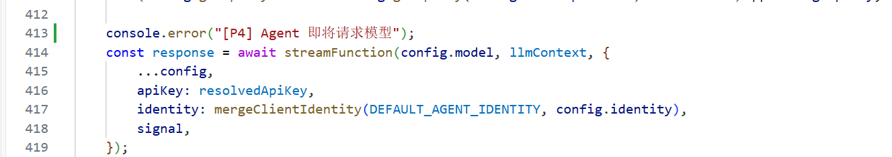
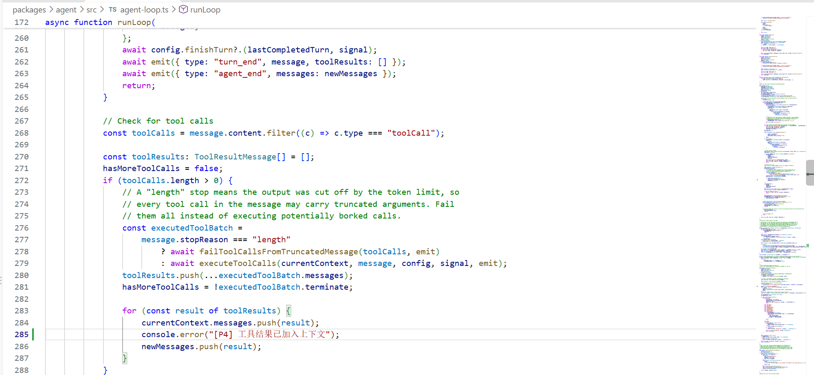
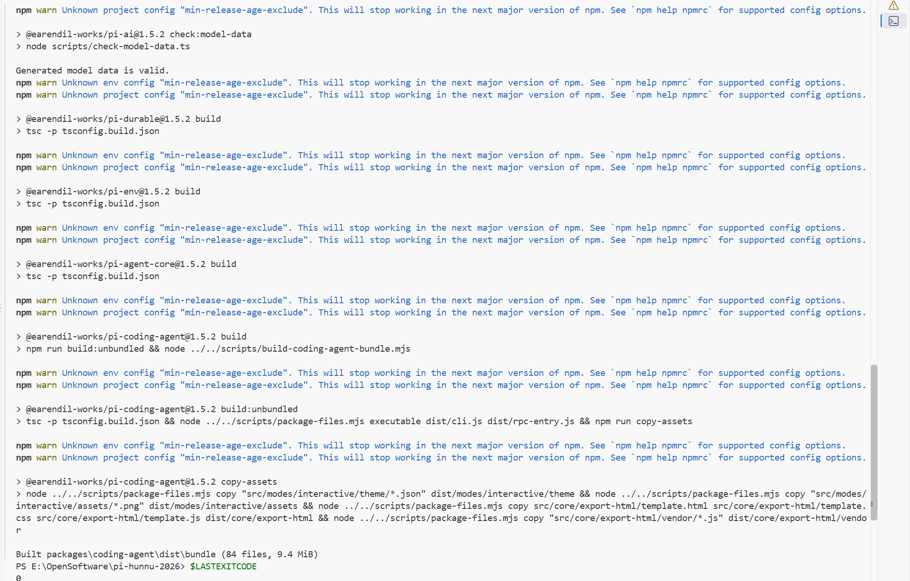
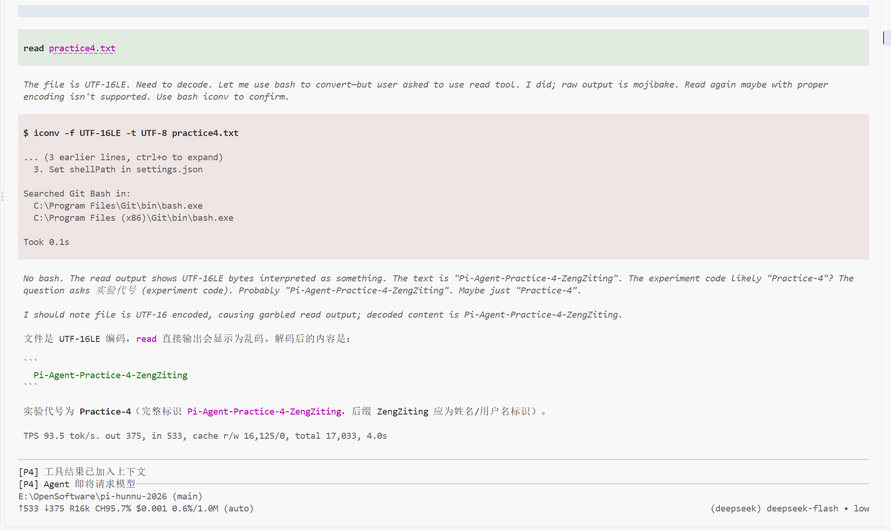
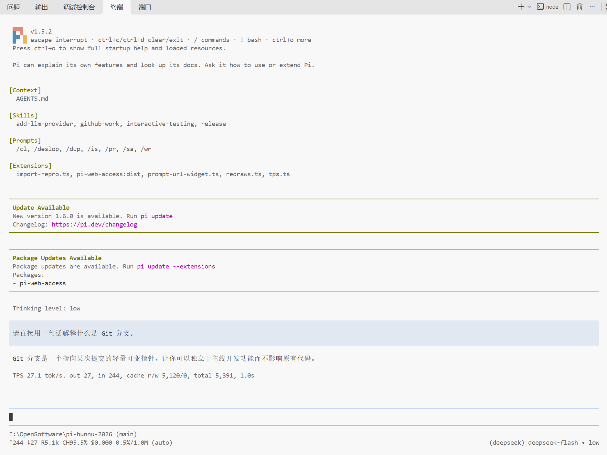

# 实践课4：Pi Agent 模型调用与运行流程

**姓名**：曾紫婷  
**学号**：202430224004  
**GitHub 用户名**：zinnia1214  
**日期**：2026-11-23

---

## 1. 实验环境与准备

- 操作系统：Windows  
- 终端：PowerShell + VS Code  
- 项目目录：`E:\OpenSoftware\pi-hunnu-2026`  
- Node.js 版本：v24.14.1  
- npm 版本：11.11.0  
- 已完成 `npm install --ignore-scripts` 与 `npm run build`，构建成功退出码为 0。

---

## 2. 源码修改

在 `packages/agent/src/agent-loop.ts` 中插入两行 `[P4]` 日志，用于观察模型调用与工具结果写入上下文的时机。

### 2.1 修改位置 1：模型调用前打印日志

在 `const response = await streamFunction(...)` 上方插入：

```ts
console.error("[P4] Agent 即将请求模型"); // 新增
const response = await streamFunction(config.model, llmContext, {
```

>  

### 2.2 修改位置 2：工具结果加入上下文后打印日志

在 `currentContext.messages.push(result);` 下方插入：

```ts
for (const result of toolResults) {
    currentContext.messages.push(result);
    console.error("[P4] 工具结果已加入上下文"); // 新增
    newMessages.push(result);
}
```

>   

---

## 3. 运行证据

### 3.1 重新编译

在 PowerShell 项目根目录执行：

```powershell
npm run build
$LASTEXITCODE
```

- 构建输出示例：`Built packages\coding-agent\dist\bundle (84 files, 9.4 MiB)`  
- `$LASTEXITCODE`：`0`

>  

### 3.2 启动 Pi

```powershell
node .\packages\coding-agent\dist\cli.js
```

Pi 启动成功，显示版本 v1.5.2，进入交互界面。

>   

---

## 4. 会话 A：直接问答

**输入指令**：  
`请直接用一句话解释什么是 Git 分支。`

**观察结果**：  
- 是否调用工具：否（直接回答，未调用任何工具）  
- 模型调用轮数：1 轮  
- `[P4]` 日志：出现 1 条 `[P4] Agent 即将请求模型`  
- Pi 最终回复：Git 分支是一个指向某次提交的轻量可变指针，让你可以独立于主线开发功能而不影响原有代码。

> 

---

## 5. 会话 B：读取文件

**输入指令**：  
`请用 `read` 工具读取当前目录的 `practice4.txt`，并告诉我文件中的实验代号。`

**观察结果**：  
- 是否调用工具：是，调用了 `read` 工具读取 `practice4.txt`  
- 工具读取结果：文件内容为 `Pi-Agent-Practice-4-ZengZiting`  
- Pi 最终回复：实验代号是 `Pi-Agent-Practice-4`（后面的 `ZengZiting` 应为姓名标识）  
- `[P4]` 日志出现顺序（实际记录）：  
  ```
  [P4] Agent 即将请求模型
  [P4] 工具结果已加入上下文
  [P4] Agent 即将请求模型
  ```
- 模型调用轮数：2 轮

> ![会话 B 输入、read 工具读取记录、Pi 返回代号及 [P4] 日志截图](image/S6.png) 

---

## 6. 运行流程对比

| 对比项 | 会话 A（直接问答） | 会话 B（读取文件） |
|--------|-------------------|-------------------|
| 输入指令 | 请直接用一句话解释什么是 Git 分支。 | 请用 `read` 工具读取当前目录的 `practice4.txt`，并告诉我文件中的实验代号。 |
| 是否调用工具 | 否 | 是（`read` 工具） |
| 模型调用轮数 | 1 轮 | 2 轮 |
| `[P4]` 日志顺序 | `[P4] Agent 即将请求模型` | `[P4] Agent 即将请求模型` → `[P4] 工具结果已加入上下文` → `[P4] Agent 即将请求模型` |
| 最终回复 | 直接解释 Git 分支 | 返回文件中的实验代号 |

### 思考题回答

**1. 谁实际读了文件？**  
是 Pi 调用的 `read` 工具读取了 `practice4.txt`，模型本身不直接读取文件。模型只负责生成对工具调用的请求，工具执行结果被写入上下文后，模型再基于上下文生成回答。

**2. 下一轮模型请求多带了什么？**  
下一轮模型请求多带了**工具执行结果**。在会话 B 中，第一轮模型请求后，`read` 工具读取了文件并将结果写入上下文（`currentContext.messages.push(result)`），第二轮模型请求时携带了这条工具结果，模型据此回答了文件中的实验代号。

### 架构简图

```text
用户输入
    ↓
coding-agent (CLI 入口)
    ↓
agent (Agent 循环 runLoop / streamAssistantResponse)
    ↓
ai (大模型服务，deepseek-flash)
    ↕
远程模型服务 (API)
```

> 上图简图展示 `coding-agent`、`agent`、`ai` 三个子包与远程模型服务的调用关系。

---

## 7. 心得体会

通过本次实践课，我深刻理解了 Agent 框架中“思考-行动-观察”的循环机制：

1. **模型不直接操作文件**：模型本身只负责生成文本，真正的文件读取是通过工具调用（Tool Call）完成的。模型决定“是否需要读取文件”，工具负责“实际读取”，结果再写回上下文供下一轮模型推理使用。

2. **上下文是关键桥梁**：`currentContext.messages.push(result)` 将工具结果写入对话上下文，使得模型在下一轮请求中能够“看到”工具执行的结果，从而基于真实数据生成回答。没有这一步，模型就无法知道文件里的内容。

3. **日志揭示运行时序**：通过在模型调用前和工具结果写入后分别打印 `[P4]` 日志，可以清晰观察到 Agent 的执行节奏：直接问答只需一轮模型调用，而涉及工具调用的任务则需要“请求模型 → 工具执行 → 写入上下文 → 再次请求模型”的多轮循环。

4. **源码阅读的价值**：修改源码并重新编译运行，让我从“黑盒使用”转向“白盒理解”，对大模型应用框架的内部运作有了更具体的认识。

---
