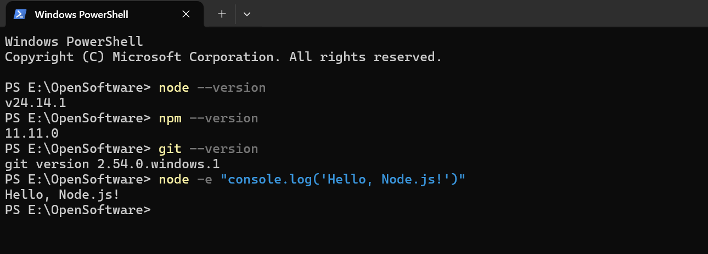
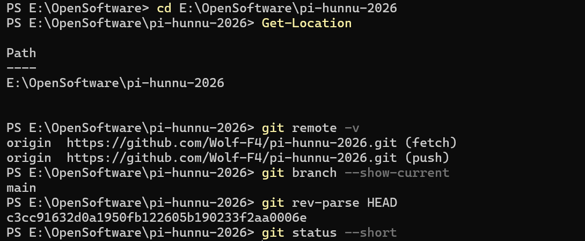
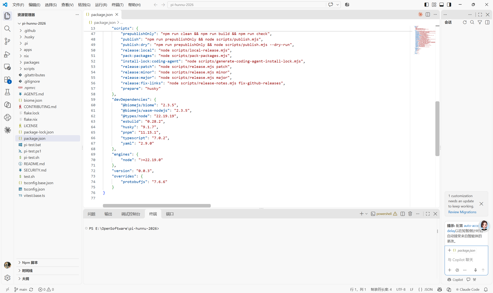
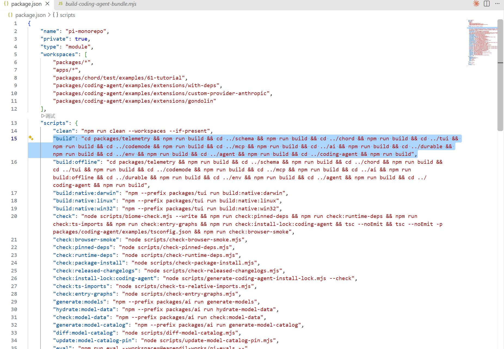
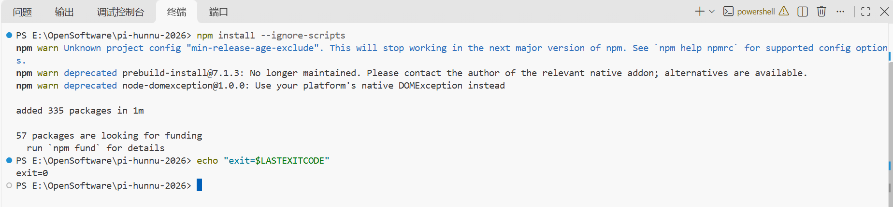
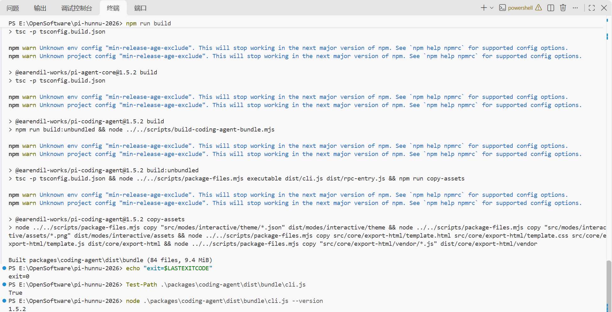
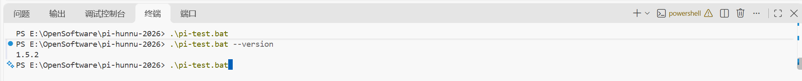
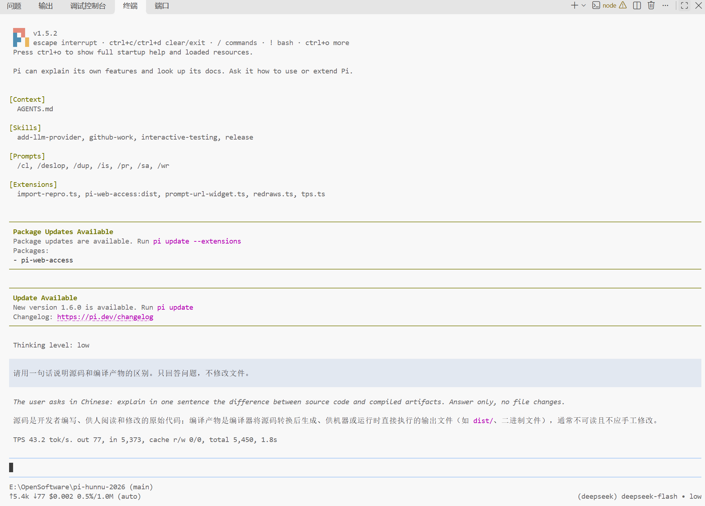
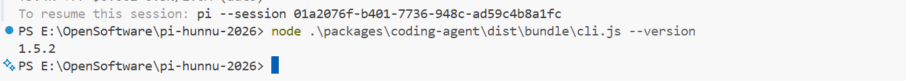

# 实践课3：Pi Agent 源码安装与编译 实验报告

| 项目 | 内容 |
|---|---|
| 姓名 | 曾紫婷 |
| 学号 | 202430224004 |
| 小组组织 | Wolf-F4 |
| 实验日期 | 2026-11-23 |
| 小组仓库 | https://github.com/Wolf-F4/pi-hunnu-2026 |
| 分支 / 提交号 | `main` / `c3cc91632d0a1950fb122605b190233f2aa0006e` |
| 实验环境 | Windows + PowerShell，仓库路径 `E:\OpenSoftware\pi-hunnu-2026`（全英文路径） |

本次实验在第二次实践课（组织建仓与源码 clone）的基础上，搭建本地源码开发环境，完成"源码在哪里、依赖装在哪里、构建执行了什么、正在运行哪个版本"四件事的验证。不要求构建独立 EXE，也不涉及大模型权重部署。

---

## 任务一 实验准备：检查开发工具（S1）

打开 PowerShell，逐条执行 `node --version`、`npm --version`、`git --version`，并用一条小程序验证 Node 能正常运行：

| 工具 | 本次用途 | 我的实际版本 | 是否满足要求 |
|---|---|---|---|
| Node.js | 运行 JavaScript 程序和项目开发脚本 | **v24.14.1** | 满足 `>=22.19.0`，且为作业建议的 24 系列 |
| npm | 安装依赖、执行项目脚本 | **11.11.0** | 随本机 Node.js 附带安装 |
| Git for Windows | 下载和管理源码 | **2.54.0.windows.1** | 可正常执行 `git --version` |

`node -e "console.log('Hello, Node.js!')"` 输出 `Hello, Node.js!`，Node 运行正常。

**我的理解：** 我直接核对了根 `package.json` 的 `engines` 字段，其值为 `>=22.19.0`；本机 Node.js 为 v24.14.1，既满足这一声明，也正好是本次实验建议统一使用的 24 LTS 系列，因此无需安装新版本，也不会出现作业图 2 中依赖声明 `>=23.6.0` 触发的 `EBADENGINE` 警告。npm 11.11.0 是该版本 Node 自带的，按要求记录实际版本即可，不必与教师截图中的版本一致。



*图 S1：Node.js、npm、Git 版本及 Hello 测试输出。*

---

## 任务二 确认源码来源与版本（S2）

源码在第二次实践课已从小组组织仓库 clone 完成，本次不重复下载，只做复核。在仓库根目录执行：

```powershell
cd E:\OpenSoftware\pi-hunnu-2026
Get-Location                # 当前目录
git remote -v               # 远端地址
git branch --show-current   # 当前分支
git rev-parse HEAD          # 完整提交编号
git status --short          # 工作区状态
```

实际结果：

- 当前目录：`E:\OpenSoftware\pi-hunnu-2026`
- 远端：`origin → https://github.com/Wolf-F4/pi-hunnu-2026.git`（fetch/push 一致）
- 分支：`main`
- 提交编号：`c3cc91632d0a1950fb122605b190233f2aa0006e`
- `git status --short` 无任何输出，工作区干净

**我的核对结论：** `Wolf-F4` 是 **Organization（小组组织）**，符合"使用小组组织内 fork 仓库"的要求；我又到仓库查看了 `main` 分支的最新提交，与本地 HEAD 的 `c3cc916…006e` 完全一致，说明本地源码就是当前最新版，可以直接在此基础上安装和构建。后续所有命令除特别说明外均在该仓库根目录执行。



*图 S2：当前目录、origin 地址、main 分支与完整提交编号。*

---

## 任务三 阅读配置，确认安装与编译的依据（S3）

用 VS Code 打开仓库根目录，重点查看了以下文件：

| 文件/目录 | 我观察到的内容 |
|---|---|
| `README.md` | Development 小节给出了 `npm install --ignore-scripts`、`npm run build`、`npm run build:offline` 等标准开发命令 |
| 根 `package.json` | `engines`、`workspaces`、`scripts`、`devDependencies`（见下） |
| `package-lock.json` | 锁定全部依赖的版本，是安装一致性的依据 |
| `packages/` | 同一仓库下的多个子包（telemetry、schema、chord、tui、codemode、mcp、ai、durable、env、agent、coding-agent 等） |
| `packages/coding-agent/package.json` | CLI 包的构建脚本与 `bin` 入口（产物入口指向 `dist/bundle/cli.js`） |

根 `package.json` 第 69–71 行的 `engines` 字段：

```json
"engines": {
  "node": ">=22.19.0"
}
```

第 15 行 `scripts` 中的 `build` 字段（内容较长，用自动换行完整查看）：

```text
"build": "cd packages/telemetry && npm run build && cd ../schema && npm run build && ... && cd ../agent && npm run build && cd ../coding-agent && npm run build"
```

第 16 行还有 `build:offline`，与 `build` 几乎相同，唯一区别是 AI 包执行 `build:offline`——这正是作业中"首次联网构建、之后可离线重建"两条命令的出处。





**问答 1：Node.js 版本要求在哪里？**

写在仓库根 `package.json` 的 `engines.node` 字段里，当前值为 `>=22.19.0`。这是项目自己声明的最低 Node 版本，安装或构建前应当先核对它，而不是从任何截图里的版本号反推要求。

**问答 2：`npm run build` 实际从哪里读取命令？**

npm 从执行时所在目录——也就是仓库根——的 `package.json` 的 `scripts.build` 读取命令。这条命令本身不编译任何代码，它用 `&&` 把 11 个子包各自的 `npm run build` 按固定顺序串起来（telemetry → schema → chord → tui → codemode → mcp → ai → durable → env → agent → coding-agent），前一步成功才执行下一步；每个子包具体做什么，再由子包自己的 `package.json` 决定。整个仓库用 npm workspaces 统一管理，所以必须从根目录安装、按根脚本顺序构建，不能给每个子包单独生成新的依赖锁定文件。

---

## 任务四 安装项目依赖（S4）

确认当前目录包含根 `package.json` 后执行：

```powershell
npm install --ignore-scripts
echo "exit=$LASTEXITCODE"    # 实际输出 exit=0
```

**这条命令做了什么（我的理解）：**

1. 以 `package.json` 和 `package-lock.json` 为依据解析依赖树，按锁定版本下载安装——本次输出 `added 335 packages in 1m`；
2. 在仓库内建立 `node_modules`，并把 `workspaces` 声明的本地子包互相链接起来；
3. 装齐构建所需的开发工具链（TypeScript、esbuild、biome 等），供后面的 `npm run build` 使用；
4. 命令没有 `-g`，装的是**当前项目**的依赖，不会把本地 Pi 变成全局 `pi` 命令；`--ignore-scripts` 跳过 `postinstall`、`prepare` 等安装期自动触发的生命周期脚本，但不影响后续主动执行的 `npm run build`。

**对输出中警告的分析：** 本次安装共出现 3 条 `npm warn`、0 条 `npm error`，退出码为 0，属于成功安装：

- `Unknown project config "min-release-age-exclude"`：仓库 `.npmrc` 中的配置项当前 npm 版本尚不认识，只是提示，不影响安装；
- `deprecated prebuild-install@7.1.3`、`deprecated node-domexception@1.0.0`：依赖包已停止维护的提醒，**不等同于安装失败**——判断成败应看退出码和有无 `npm error`，而不是看有没有警告文字；
- 因为使用 Node 24，本次没有出现 `EBADENGINE`；依赖审计结果如实记录，我**没有**执行 `npm audit fix --force`，以免改变课程锁定的依赖版本。



*图 S4：安装汇总、警告与 `exit=0`。*

---

## 任务五 本地编译与构建产物验证（S5）

### 1. 首次构建

在仓库根目录执行：

```powershell
npm run build
echo "exit=$LASTEXITCODE"    # 实际输出 exit=0
```

构建日志清晰呈现了三层调用关系：根 `scripts.build` → 各子包自己的 `build` → 子包内部的编译器或脚本（如 `tsc -p tsconfig.build.json`、`node scripts/build-coding-agent-bundle.mjs`、`copy-assets` 等）。首次构建需要联网，AI 包据此刷新**模型目录、能力等配置数据**——这只是配置数据，不是下载大模型权重，本地客户端构建与模型推理服务是两件独立的事。日志最终停在最后一个子包：

```text
> @earendil-works/pi-coding-agent@1.5.2 build
...
Built packages\coding-agent\dist\bundle (84 files, 9.4 MiB)
```

### 2. 检查并运行构建产物

```powershell
Test-Path .\packages\coding-agent\dist\bundle\cli.js      # True
node .\packages\coding-agent\dist\bundle\cli.js --version # 1.5.2
```

`Test-Path` 返回 `True`，说明 CLI 入口产物存在；运行得到版本 `1.5.2`，即当前源码对应的 Pi 版本。该入口来自 CLI 包 `package.json` 的 `bin.pi` 配置。`dist/` 保存构建产物，以后修改程序应改 `src/` 下的源码再重新构建，直接改 `dist/` 中的文件会在下次构建时被覆盖。

### 3. 后续重新构建

首次成功且模型目录数据已就绪后，日常重建可用 `npm run build:offline`：它仍会重新编译各子包，但复用已有模型目录数据、无需联网。它不能替代首次安装或首次数据初始化；若提示数据缺失或过期，恢复网络后重新执行 `npm run build` 即可。



*图 S5：构建最后输出、`exit=0`、`Test-Path` 返回 `True`、产物运行版本 1.5.2。*

---

## 任务六 启动本地源码版本并完成一次会话（S6）

### 1. 验证源码入口

```powershell
.\pi-test.bat --version    # 1.5.2
.\pi-test.bat
```

`pi-test.bat` 名字里虽然有 "test"，但它不是测试套件，而是运行本地源码的入口：当前 `.bat` 以 `-ExecutionPolicy Bypass` 调用同目录的 `pi-test.ps1`，由 Node.js 加载本仓库 `packages/coding-agent/src/cli.ts` 运行。

### 2. 启动交互界面并完成会话

启动后界面头部显示 `v1.5.2`，并加载了本仓库内的 `AGENTS.md`、Skills、Prompts、Extensions 等资源。我没有输入全局 `pi` 命令——那样可能启动第一次实践课安装的全局版本，无法证明运行的是刚下载的源码。

发送测试提示：

```text
请用一句话说明源码和编译产物的区别。只回答问题，不修改文件。
```

模型（deepseek-flash）实际回复：

> 源码是开发者编写、供人阅读和修改的原始代码；编译产物是编译器将源码转换后生成、供机器或运行时直接执行的输出文件（如 dist/、二进制文件），通常不可读且不应手工修改。

状态栏显示工作目录为 `E:\OpenSoftware\pi-hunnu-2026 (main)`，说明会话确实在本仓库内发起；模型正常返回，本地程序启动与模型调用都成功（本地源码版与已安装的 Pi 共用 `~/.pi/agent` 配置，01 已登录，因此没有重复 `/login`）。用 `/quit` 退出后，再运行编译产物入口作对比：

```powershell
node .\packages\coding-agent\dist\bundle\cli.js --version   # 1.5.2
```

两个入口版本一致，均为 **1.5.2**。此外还有一个有趣的现象：源码版启动时提示 "Update Available: New version 1.6.0"——这反过来印证了当前运行的正是本地 1.5.2 源码，而不是全局安装的较新版本。







**问答 3：本次如何确保运行的是本地源码？**

我始终在本仓库根目录执行 `.\pi-test.bat`，而不是直接输入全局 `pi`。`.bat` 会调用 `pi-test.ps1`，由 Node.js 加载**本仓库**的 `packages/coding-agent/src/cli.ts` 源文件运行。可以佐证的证据有三条：启动头版本为 1.5.2，与刚才构建的产物版本一致；启动过程加载的是本仓库内的 AGENTS.md 和扩展资源；界面提示可升级到 1.6.0——如果跑的是全局安装的最新版，就不会出现这些特征。

**问答 4：源码入口与 `dist/bundle/cli.js` 入口分别适合什么场景？**

`.\pi-test.bat` 直接执行 TypeScript 源码，改完 `src/` 立即生效、不必先构建，适合日常开发调试和快速验证修改；`dist/bundle/cli.js` 是 `npm run build` 打出的编译产物入口，形态与发布版一致、启动更快，适合检查构建结果、体验最终交付形态。两者版本号一致（1.5.2），说明这份产物确实是由当前源码构建出来的。

---

## 遇到的困难与解决过程（重点）

**困难 1：在编辑器里一开始找不到 `scripts.build`。**

打开根 `package.json` 时，`scripts` 从第 13 行开始，而视图停在第 47 行（`prepublishOnly` 附近），我上下翻了一会儿都没有看到 `build` 字段，一度以为这个仓库没有构建脚本。解决：用 VS Code 的 `Ctrl+G` 输入行号 15 直接跳转，再按 `Alt+Z` 打开自动换行，把从 `cd packages/telemetry` 一直到 `cd ../coding-agent && npm run build` 的整条链式命令完整看清并截图。这次也提醒我：JSON 配置里"没看到"不等于"不存在"，长行会被折行或需要滚动，用行号定位比肉眼翻更可靠。

**困难 2：安装输出里警告很多，难以确定安装到底成没成功。**

首次跑 `npm install --ignore-scripts` 时，输出里混着 `Unknown project config`、两条 `deprecated` 提示，和作业截图里的"漏洞/弃用"描述长得差不多，我一时分不清哪些是警告、哪些是会导致失败的错误。解决：明确判断标准——**看退出码，不看文字**。执行 `echo $LASTEXITCODE` 得到 `exit=0`，且全程没有出现 `npm error`，确认安装成功、那几条只是警告；同时按作业要求没有执行 `npm audit fix --force`，避免为了"消警告"反而改动课程使用的依赖版本。

**困难 3：目标文件夹已存在，无法照作业示例重新 clone 来验证来源。**

作业示例是"新建目录 → clone → 检查"，但我的 `E:\OpenSoftware\pi-hunnu-2026` 在第二次实践课就已经建好了，作业明确要求"目标文件夹已存在时不要直接删除或覆盖"，所以不能重来一遍了事。解决：改用只读命令核验——`git remote -v` 确认 `origin` 指向 `Wolf-F4/pi-hunnu-2026`，再到 GitHub 核实 `Wolf-F4` 的类型是 Organization（小组组织）而非个人账号，最后比对本地 HEAD 与教师组织仓库 `main` 的最新提交完全一致，确认"这就是本次所需仓库、且是最新版"后才继续安装。这让我理解了作业强调"仅打开 GitHub 网页不能证明源码已下载到本地"的用意：本地仓库的身份要靠 `git` 命令自己查出来。

---

