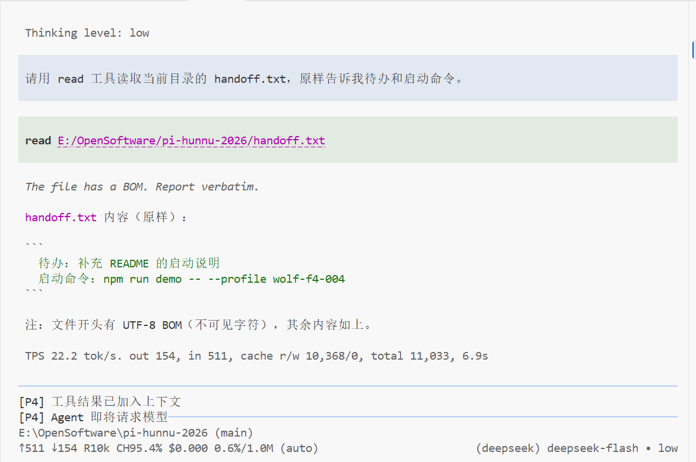
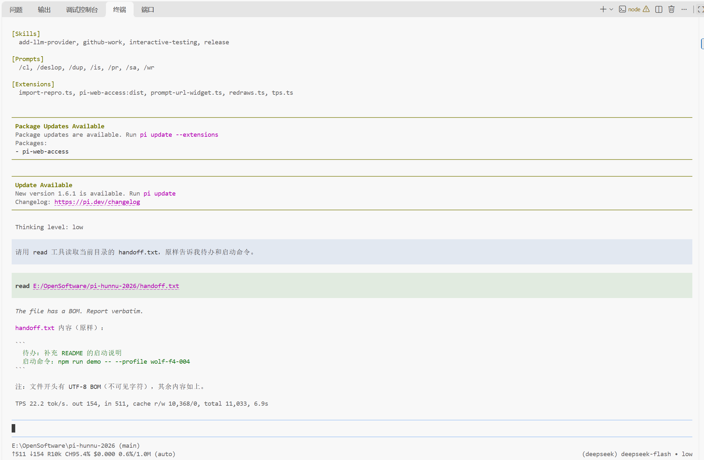
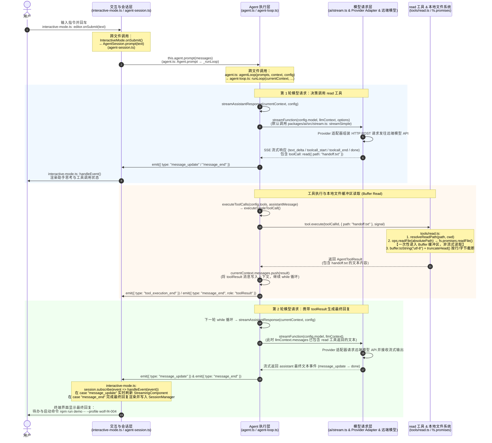
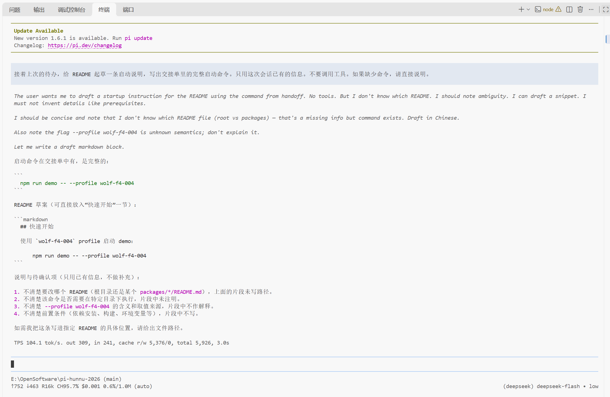
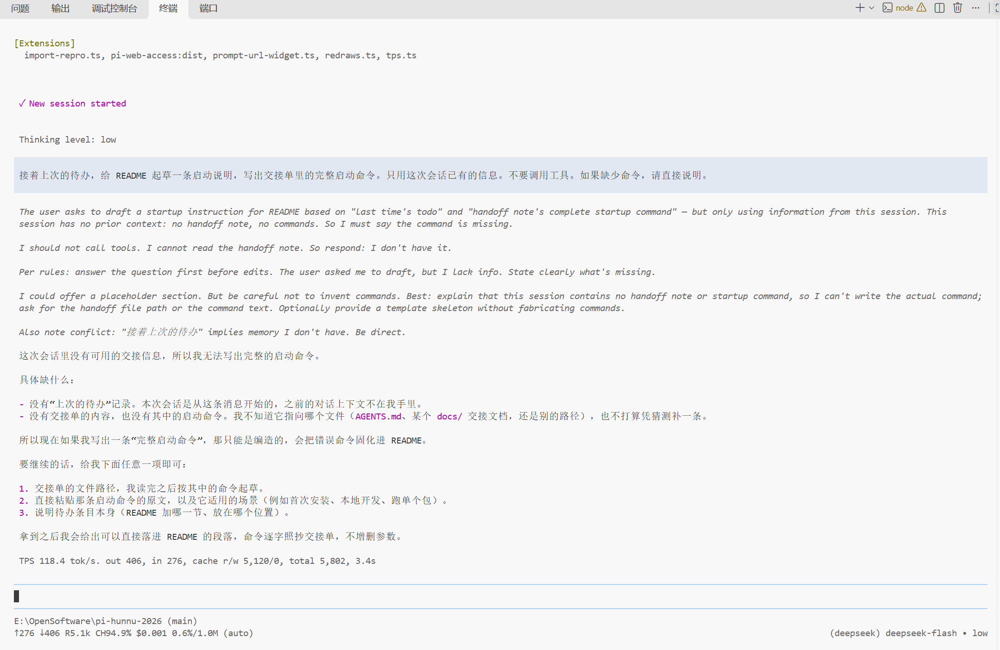
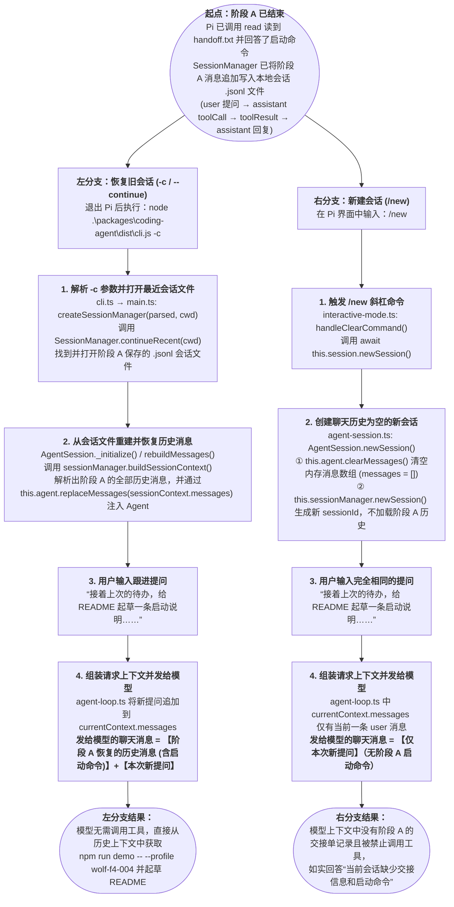

# 实践课5：Pi Agent 工具调用与会话恢复（源码泛读与功能定位）

**姓名**：曾紫婷  
**学号**：202430224004  
**GitHub 用户名**：zinnia1214  
**日期**：2026-11-23

---

## 1. 实验环境与准备

- 操作系统：Windows  
- 终端：PowerShell + VS Code  
- 项目目录：`E:\OpenSoftware\pi-hunnu-2026`  
- 实验交接单文件：`handoff.txt`（组内标识：`wolf-f4-004`）  
- 文件内容：
  ```text
  待办：补充 README 的启动说明
  启动命令：npm run demo -- --profile wolf-f4-004
  ```

---

## 2. 阶段 A：单轮交互与工具调用

### 2.1 实验操作与运行结果

在项目根目录启动本地构建的 Pi（`node .\packages\coding-agent\dist\cli.js`），在新会话中输入指令：

> `请用 read 工具读取当前目录的 handoff.txt，原样告诉我待办和启动命令。`

**实际观察记录**：
1. **工具调用次数**：执行了 **1 次** `read` 工具调用（`read E:/OpenSoftware/pi-hunnu-2026/handoff.txt`）。
2. **模型调用轮数**：本轮用户交互共触发了 **2 次**模型请求：
   - 第 1 次请求模型：模型收到用户指令后，决定发出 `read` 工具调用请求（`toolCall`）；
   - 工具执行并写入上下文：本地执行 `read` 工具读取 `handoff.txt`，打印 `[P4] 工具结果已加入上下文`；
   - 第 2 次请求模型：打印 `[P4] Agent 即将请求模型`，模型结合 `toolResult` 中的文件内容生成最终文字回复。
3. **Pi 最终回复**：原样输出了待办（`补充 README 的启动说明`）与启动命令（`npm run demo -- --profile wolf-f4-004`）。




---

### 2.2 图 1：单轮工具调用的代码级时序图

下面以实际读取 `handoff.txt` 的这轮交互为例，按 **用户**、**交互与会话层**、**Agent 执行层**、**模型请求层**、**`read` 工具** 五条生命线绘制代码级时序图（GitHub 原生支持 Mermaid 渲染）：



### 2.3 图 1 关键源码位置核对说明

| 关键环节 | 所在源码文件 | 核心函数 / 语句 | 源码行为说明 |
| :--- | :--- | :--- | :--- |
| **1. 输入入口** | `packages/coding-agent/src/modes/interactive/interactive-mode.ts` | `this.editor.onSubmit = async (text: string) => { ... await this.session.prompt(text); }` | 用户在底部编辑器按回车后触发 `onSubmit`，将输入文本传给 `AgentSession.prompt()`。 |
| **2. 会话到 Agent** | `packages/coding-agent/src/core/agent-session.ts` | `await this.agent.prompt(messages)` | `AgentSession.prompt()` 处理斜杠命令与扩展钩子后，调用 `Agent.prompt()`。 |
| **3. 启动循环** | `packages/agent/src/agent.ts`<br/>`packages/agent/src/agent-loop.ts` | `Agent.prompt()` → `this._runLoop()` → `agentLoop()` → `runLoop()` | 在 `runLoop` 的双层 `while` 循环中，先调用 `streamAssistantResponse` 请求模型；若返回 `toolCalls`（`pendingToolCalls.length > 0`），则调用 `executeToolCalls` 并把 `toolResult` 推入 `currentContext.messages`，进入下一轮模型请求。 |
| **4. 模型与文件边界** | **模型侧**：`packages/ai/src/stream.ts`<br/>**文件侧**：`packages/coding-agent/src/core/tools/read.ts` | `streamSimple()` → Provider HTTP/SSE 流<br/>`ops.readFile(absolutePath)` (`fs.promises.readFile`) | 模型请求层只负责把 `llmContext` 转成远端 API 请求并解析流式响应；本地文件读取由 `read.ts` 完成。**经核对 `read.ts` 源码，实际采用的是缓冲区读取（`await fs.readFile(path)` 一次性读入 `Buffer`，再 `buffer.toString("utf-8")` 并通过 `truncateHead` 截断），而不是流式（Stream）读取。** |
| **5. 显示回复** | `packages/coding-agent/src/modes/interactive/interactive-mode.ts` | `this.session.subscribe(event => this.handleEvent(event))` 中的 `case "message_update":` 与 `case "message_end":` | 在 `message_update` 分支中增量更新 `streamingComponent` 实时渲染模型打字机输出；在 `message_end` 分支中完成助手消息组件的最终落盘与界面刷新。 |

---

## 3. 阶段 B：恢复上次会话 vs 新建会话

### 3.1 实验对比记录

退出阶段 A 的 Pi 进程后，在同一目录、同一模型（`deepseek-flash`）下对比两种操作，输入完全相同的指令：

> `接着上次的待办，给 README 起草一条启动说明，写出交接单里的完整启动命令。只用这次会话已有的信息。不要调用工具。如果缺少命令，请直接说明。`

#### （1）恢复原会话（`node .\packages\coding-agent\dist\cli.js -c`）
- **是否看到阶段 A 聊天记录**：是，终端直接渲染出阶段 A 读取 `handoff.txt` 的历史对话。
- **是否调用工具**：**否**（0 次工具调用）。
- **Pi 回答结果**：直接写出了完整的启动命令 `npm run demo -- --profile wolf-f4-004`，并起草了 README 的“快速开始”Markdown 片段。这证明 `-c` 成功从持久化的会话文件中恢复了阶段 A 的历史消息（包含 `read` 工具结果和助手回复），并将其一并发送给了模型。



#### （2）新建会话（输入 `/new`）
- **界面变化**：提示 `✓ New session started`，历史界面清空。
- **是否调用工具**：**否**（0 次工具调用）。
- **Pi 回答结果**：明确指出“这次会话里没有可用的交接信息，所以我无法写出完整的启动命令”，并说明当前会话是从这条消息才开始的，没有之前的对话上下文，也没有交接单内容。



#### （3）两次会话结果对照表

| 对比维度 | B-1：恢复旧会话（`-c` / `--continue`） | B-2：新建会话（`/new`） |
| :--- | :--- | :--- |
| **启动 / 切换方式** | `node .\packages\coding-agent\dist\cli.js -c` | 在交互界面输入 `/new` |
| **输入提问** | 接着上次的待办，给 README 起草一条启动说明…… | 接着上次的待办，给 README 起草一条启动说明……（完全相同） |
| **是否调用工具** | 否 | 否 |
| **发给模型的历史上下文** | 包含阶段 A 的完整历史消息（用户提问 + `read` 调用与结果 + 助手回复）+ 本次新提问 | 历史消息为空（`[]`），仅包含本次新提问 |
| **最终回答** | 成功写出完整命令 `npm run demo -- --profile wolf-f4-004` 及 README 草案 | 明确说明缺少上次待办和交接单命令信息，拒绝编造命令 |

---

### 3.2 图 2：恢复旧会话和新建会话的对照图

下图从“**阶段 A 已经结束，Pi 已经读到并回答了启动命令**”开始，展示两条分支在源码层面的处理路径，以及最终发给模型的 `messages` 差异：



### 3.3 阶段 B 源码定位补充说明

1. **`-c`（`--continue`）恢复历史消息的源码路径**：
   - 命令行参数解析：`packages/coding-agent/src/cli/args.ts` 将 `-c` / `--continue` 解析为 `parsed.continue = true`。
   - 会话管理器初始化：`packages/coding-agent/src/main.ts` 的 `createSessionManager()` 中，当 `parsed.continue` 为真时调用 `SessionManager.continueRecent(cwd, sessionDir)`（定义于 `packages/coding-agent/src/core/session-manager.ts`），定位最近一次写入的 `.jsonl` 会话文件并加载条目。
   - 注入 Agent 上下文：在 `packages/coding-agent/src/core/agent-session.ts` 中，通过 `this.sessionManager.buildSessionContext()` 沿着会话树回溯还原出 `sessionContext.messages`，再调用 `this.agent.replaceMessages(sessionContext.messages)` 将阶段 A 的消息恢复进 `Agent.state.messages`。
2. **`/new` 新建空会话的源码路径**：
   - 命令分发：`packages/coding-agent/src/modes/interactive/interactive-mode.ts` 识别到 `/new` 后调用 `handleClearCommand()`。
   - 清空上下文：`handleClearCommand()` 调用 `this.session.newSession()`（位于 `agent-session.ts`），内部执行 `this.agent.clearMessages()` 将 `this._state.messages` 置为空数组 `[]`，同时调用 `this.sessionManager.newSession()` 开启全新的会话记录。

---

## 4. 心得体会

通过本次实践课 5 的源码泛读与实验验证，我对 Pi Agent 的整体代码架构有了更清晰的脉络感：

1. **理清了从 UI 到工具再到远端模型的分层边界**：通过绘制五条生命线的代码级时序图，我弄清楚了 `interactive-mode.ts`（负责终端 UI 输入输出与事件订阅）、`agent-session.ts`（负责会话生命周期与持久化协调）、`agent-loop.ts`（负责多轮推理与工具调度）、`ai/stream.ts`（负责协议适配与远端 API 通信）以及 `tools/read.ts`（负责本地 `fs.promises.readFile` 缓冲区读取）各自职责清晰、互不越界。
2. **理解了大模型“记忆”的本质是会话上下文重放**：远端大模型本身是无状态的。阶段 B 的对比实验直观展示了：之所以 `-c` 能“记住”上次读到的启动命令，是因为 `SessionManager` 从 `.jsonl` 文件还原了阶段 A 的历史消息列表，并在新请求时连同新问题一起发给了模型；而 `/new` 调用了 `agent.clearMessages()`，模型只收到当前一句话，自然无法得知交接单里的命令。
3. **学会了顺着事件与调用链定位源码修改点**：如果以后要修改 UI 显示效果，应该去 `interactive-mode.ts` 的 `handleEvent`；如果要修改工具行为或文件读取方式，应该去 `packages/coding-agent/src/core/tools/`；如果要修改多轮循环或上下文裁剪策略，则应该定位到 `agent-loop.ts` 和 `agent-session.ts`。

---