# 实践课1：Pi Agent 安装与基础使用实验报告

- 姓名：曾紫婷
- 学号：202430224004
- GitHub 用户名：zinnia1214
- 实验日期：2026-11-09

## 一、实验目的

1. 安装并启动 Pi Agent，配置模型并完成会话。
2. 切换模型和思考级别，使用文件引用和图片输入。
3. 安装并试用插件，安装、发现和调用 PPT Skill。

## 二、实验环境

- 操作系统：Windows
- Pi Agent 版本：v1.5.0
- 工作目录：`E:\OpenSoftware\pi-test`
- Git Bash：`E:\develop\Git\bin\bash.exe`
- 模型提供商：DeepSeek

## 三、实验过程与结果

### 任务一：安装并启动 Pi

使用 Pi 官方安装器安装客户端，在练习目录启动 Pi。启动界面显示版本 v1.5.0 和工作目录。启动时 `fd` 与 `ripgrep` 自动下载超时，但 Pi 界面仍成功启动。

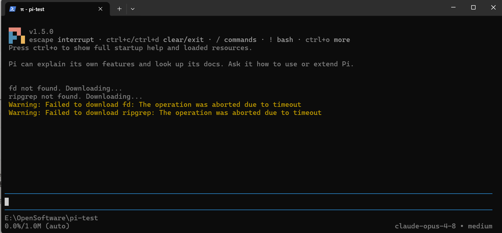

### 任务二：配置模型并完成会话

配置 DeepSeek API 后，选择 `deepseek-flash` 发送提示词，并成功收到回复。

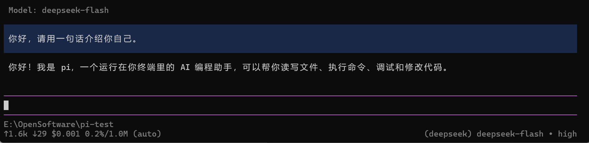

### 任务三：切换模型与思考级别

使用过 `deepseek-flash` 和 `deepseek-v4-pro`，两者均成功回复。截图显示 Flash 的 high、low 级别及 Pro 的 max 级别。

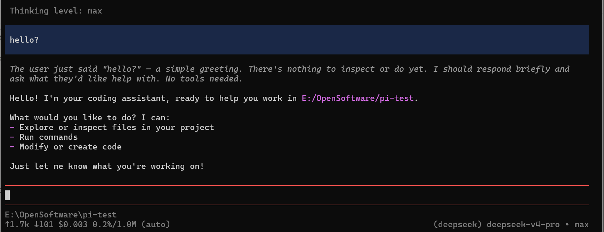
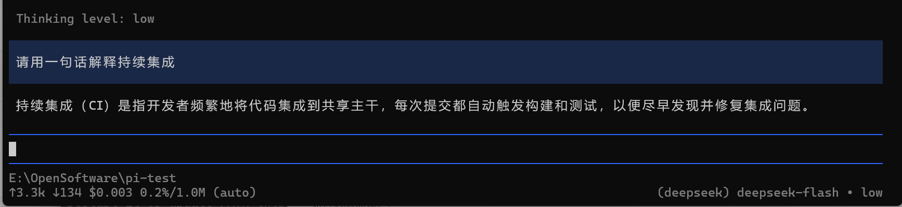

简单任务可考虑较低思考级别；复杂任务可考虑较高思考级别，但后者可能增加等待时间和用量，不保证结果一定更好。

### 任务四：引用代码文件与测试图片

#### 代码引用

在项目目录创建 `hello.py`。通过 `@` 候选列表定位文件，请求解释功能和运行结果。Pi 读取文件并解释 `add` 函数，指出输出为 `5`。

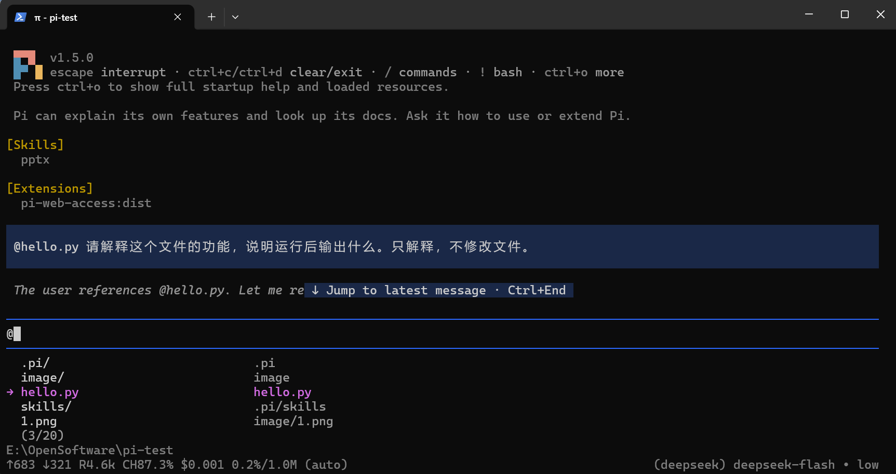
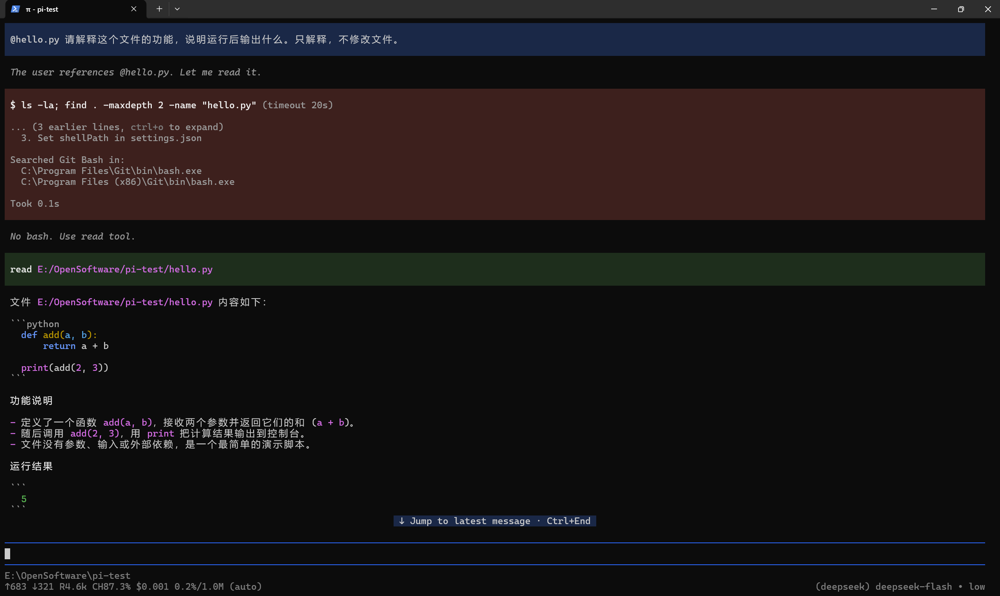

#### 图片测试

使用剪贴板图片进行测试，询问颜色、形状和数字。截图显示 Pi 读取临时图片路径，并回复图片包含红色方块和数字 1。报告附上原图以便核对。

原始图片：

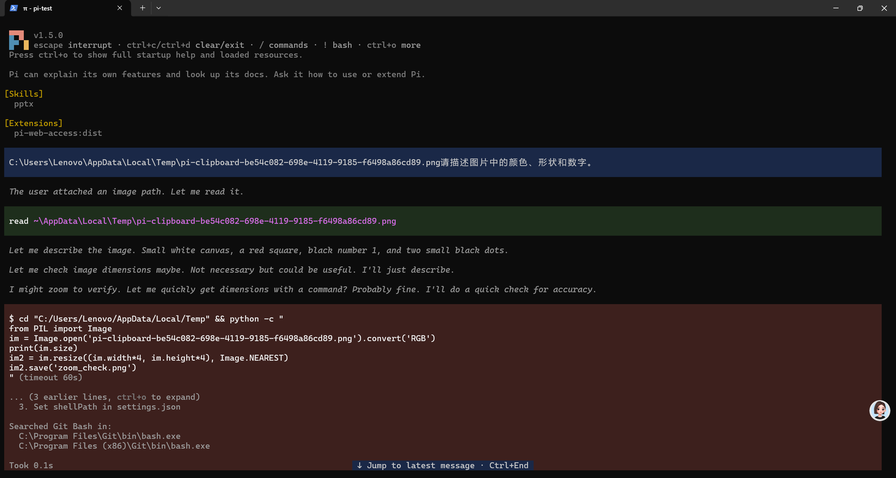
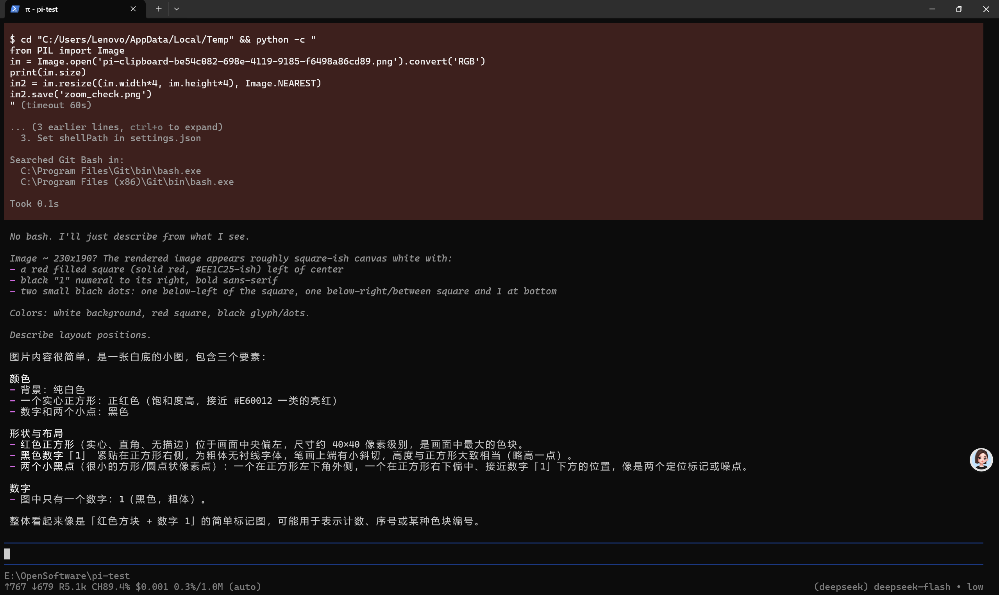

### 任务五：安装并试用插件

- 插件：`pi-web-access`
- 来源：[Pi Packages](https://pi.dev/packages)，npm 包 `pi-web-access`
- 安装命令：`pi install npm:pi-web-access`
- 作用：提供网页获取等网络访问功能。
- 配置：本次截图显示启用 web 工具后成功获取页面，具体配置要求以插件说明为准。

重新启动 Pi 后，启动资源列表出现 `pi-web-access:dist`。请求获取 `https://example.com` 的页面标题，工具调用返回 `Example Domain`。第一次请求出现 403，重试后成功。

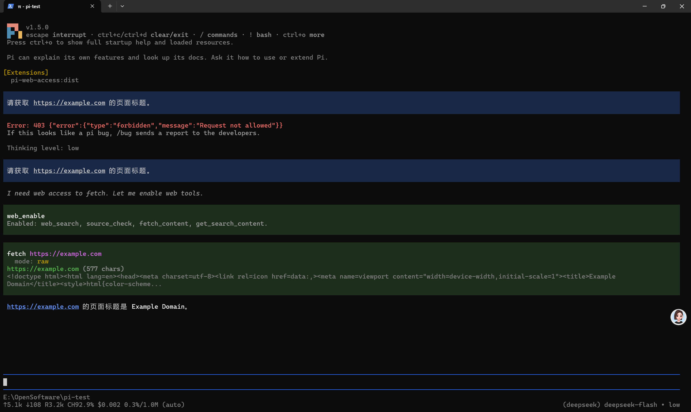

### 任务六：安装并调用 PPT Skill

通过 Pi 将 `anthropics/skills` 仓库中的 `skills/pptx` 安装到当前项目的 `.pi/skills/pptx`。安装结果中记录的源 commit 为 `2c5958ecac7cee2b583967a2c4981d0f4a75c579`；未自动安装依赖。

目录中可见 `SKILL.md`、`LICENSE.txt` 和 `scripts`。

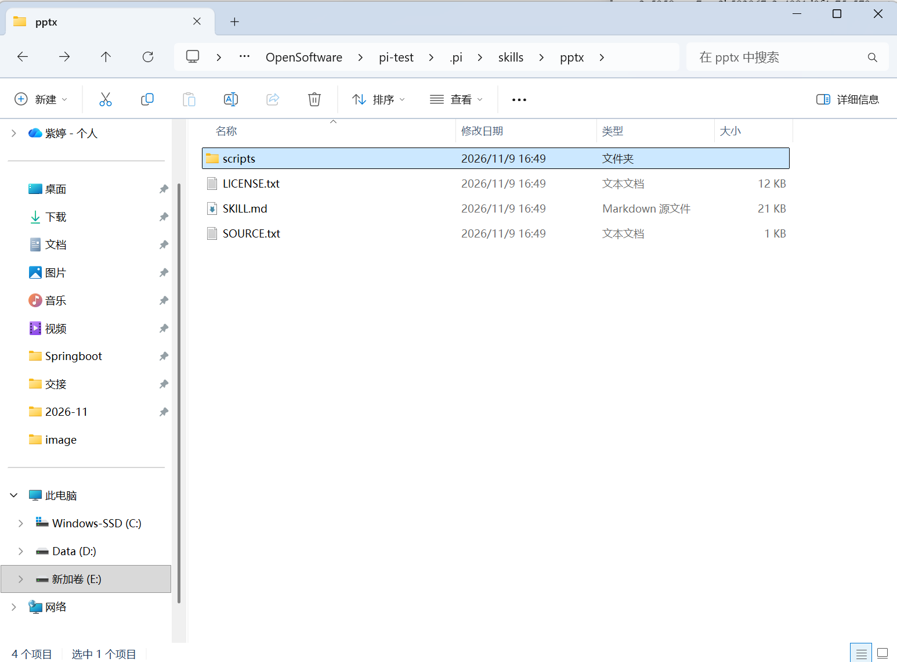
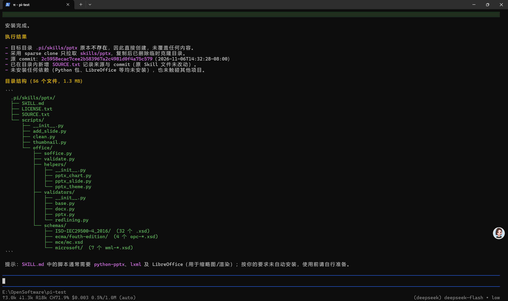

重新启动 Pi 后，`[Skills]` 显示 `pptx`；调用 Skill 后获得名称、用途和本次安装目录的说明。

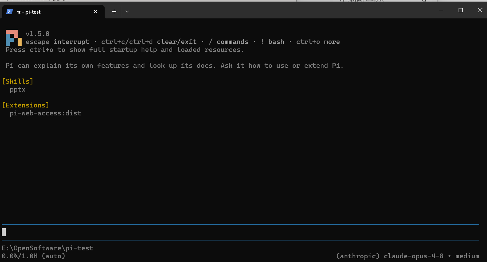
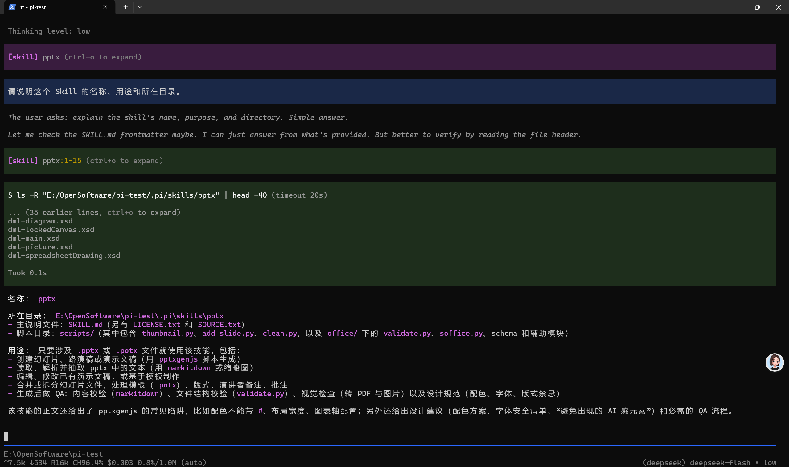

## 四、遇到的问题与解决

1. **Portable Git 下载失败**：安装器下载时连接中断；检查发现电脑已有 Git，重新运行安装器时跳过 Portable Git 下载。
2. **Pi 找不到 Bash**：Git 位于非默认目录。确认 `E:\develop\Git\bin\bash.exe` 可运行后，在项目 `.pi/settings.json` 配置 `shellPath`，重新启动并用 `pwd` 测试成功。
3. **辅助工具下载超时**：启动时 `fd` 和 `ripgrep` 下载超时；Pi 仍能启动，截图保留了警告。

## 五、实验总结

通过本次实践，我对 Pi Agent 的安装、配置和基本使用有了较为完整的认识。实践过程中，我不仅学会了配置 DeepSeek API、切换模型和思考级别，还尝试了引用代码文件、输入图片、安装插件和调用 Skill，体会到了 AI 编程助手在代码理解、信息获取和任务辅助等方面的作用。
在操作过程中，我也遇到了 Portable Git 下载失败、Pi 无法找到 Git Bash 等问题。通过查看报错信息、检查 Git 的实际安装路径并修改配置，最终解决了问题。这让我认识到，遇到错误时不应只反复重试，而应先区分是网络、环境还是配置问题，再有针对性地排查。
此外，插件和 Skill 的实践让我了解到，安装成功并不等于功能已经可用，还需要通过重启、查看加载信息和实际调用逐步验证。使用 AI 时，也不能完全依赖它的文字说明，而应结合文件目录、命令执行结果和截图进行核对。今后我会继续学习如何更准确地描述任务，并注意保护 API 密钥等敏感信息，提高使用 AI 工具解决实际问题的能力。
